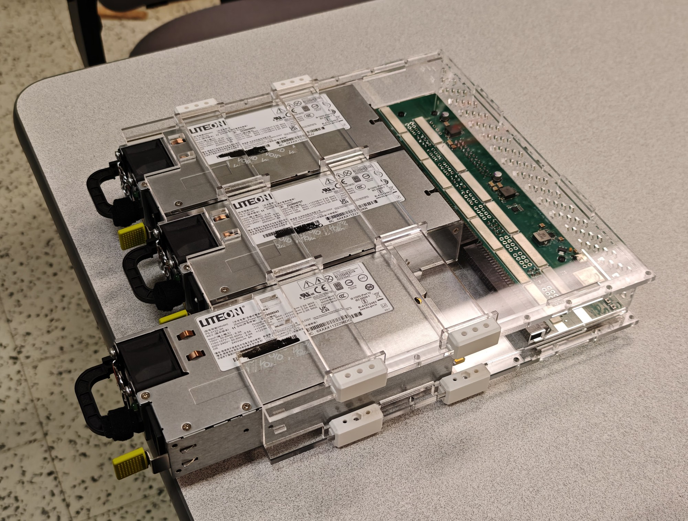
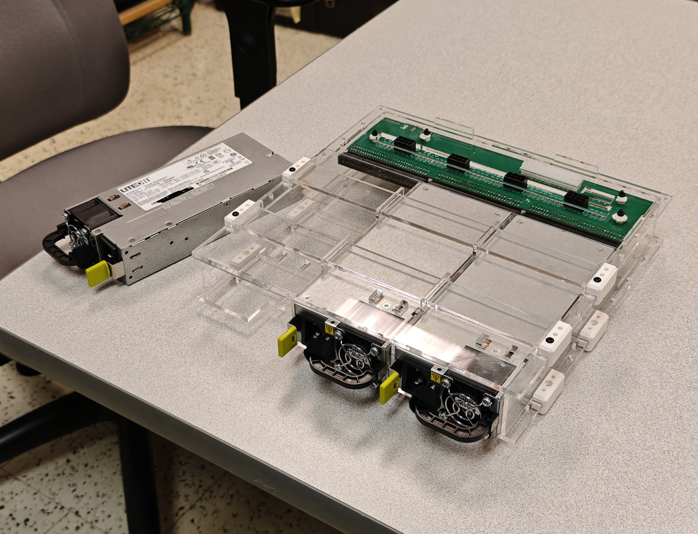

# PowerRAID: Open-Hardware 1800W Workstation Power Supply Backplane

PowerRAID is an open-hardware managed backplane that repurposes three retired server power supplies (Lite-On PS-2122-3H / Murata D1U86 / HP Common Slot) into an 1800W redundant, high-efficiency ATX/EPS power array for GPU research workstations.

> [!NOTE]  
> The manuscript describing this system and its empirical validation is currently under preparation for submission to *HardwareX*. Experimental validation datasets (`Analysis.zip`) and publication DOIs will be released alongside the preprint.

  
  

## Release Archives
The following release archives are prepared for open-science archival deposits (Zenodo / OSF):

| Archive | Contents | Licence |
| :--- | :--- | :--- |
| **[`KiCad-Src.zip`](KiCad-Src.zip)** | KiCad 10.0 schematic and 4-layer PCB layout source files | CERN-OHL-P-2.0 |
| **[`V2-PCB.zip`](V2-PCB.zip)** | PCB production package (Gerbers, SMT BOM, CPL coordinates, fabrication specs) | CERN-OHL-P-2.0 |
| **[`Enclosure.zip`](Enclosure.zip)** | Enclosure laser-cut DXFs, 3D printed part STEP files, and assembly models | CERN-OHL-P-2.0 |
| **[`firmware.zip`](firmware.zip)** | Pre-compiled ESP32-S3 firmware release binaries | Apache-2.0 |
| **`Analysis.zip`** | Experimental validation datasets and Python analysis scripts *(Available upon preprint publication)* | CC-BY-4.0 |

## Repository Structure
- **`firmware/`**: ESP32-S3 microcontroller C++ firmware (`platformio.ini`, `src/`).
- **`pramon/`**: Modern reactive web dashboard written in Svelte 5 and TypeScript.
- **`images/`**: System photographs and hardware documentation visuals.
- **`LICENSES/`**: Legal licence texts (CERN-OHL-P-2.0, Apache-2.0, CC-BY-4.0).
- **`LICENSING.md`**: Tripartite licensing terms and rationale.

## Licensing
- **Hardware design files:** CERN-OHL-P-2.0
- **Firmware and software:** Apache-2.0
- **Documentation, data, and figures:** CC-BY-4.0

See [`LICENSING.md`](LICENSING.md) for full terms and rationale.
